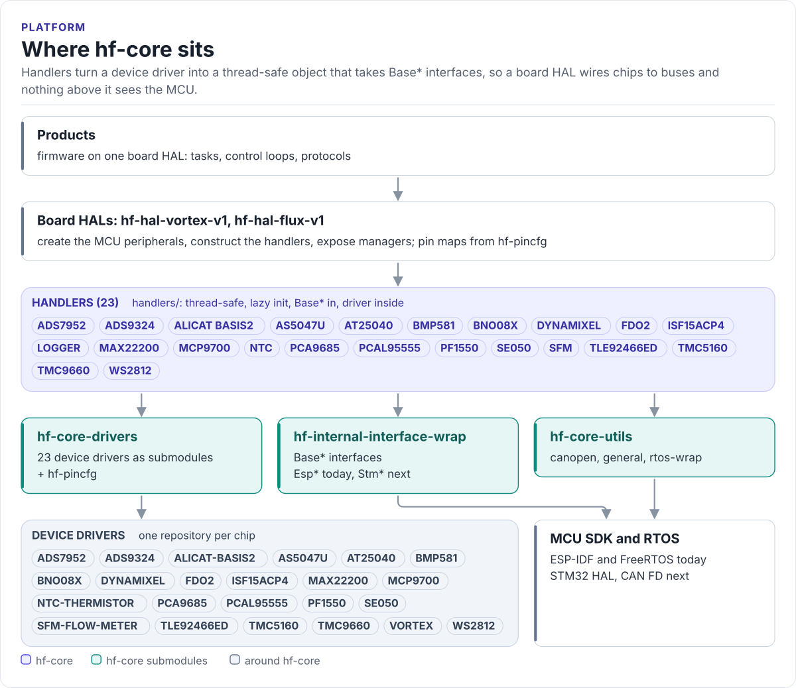

# HardFOC Core

The layer between the HardFOC device drivers and a board HAL: thread-safe handlers that take `Base*`
interfaces, the MCU interfaces, RTOS wrappers and utilities they need, and a host build with mocks to test all
of it without hardware.

[](https://github.com/hardfoc/hf-core/actions/workflows/host.yml)
[](https://github.com/hardfoc/hf-core/actions/workflows/esp32-examples-build-ci.yml)
[](https://hardfoc.github.io/hf-core/)

**Documentation: <https://hardfoc.github.io/hf-core/>**

<!-- figure: platform-layers -->
<picture>
  <source media="(prefers-color-scheme: dark)" srcset="docs/diagrams/platform-layers.dark.svg">
  
</picture>
<!-- /figure -->

## In 30 seconds

Turn on a handler in CMake (`set(HF_CORE_ENABLE_PCAL95555 ON)`), give it the `BaseI2c` device your HAL created,
and call it from any task:

<!-- generated: quickstart-code -->
```cpp
#include "HandlerCommon.h"
#include "Pcal95555Handler.h"

// `i2c` is the expander's BaseI2c device, created by the board HAL
// (an EspI2cDevice on ESP32, a hf::host::MockI2c in a host test).
bool BlinkStatusLed(BaseI2c& i2c) {
  Pcal95555Handler expander(i2c);              // no bus traffic yet
  if (!expander.EnsureInitialized()) {         // probes the chip once
    return false;                              // wiring, address or power
  }

  constexpr uint8_t kLedPin = 3;
  if (expander.SetDirection(kLedPin, hf_gpio_direction_t::HF_GPIO_DIRECTION_OUTPUT) !=
      hf_gpio_err_t::GPIO_SUCCESS) {
    return false;
  }
  for (int i = 0; i < 6; ++i) {
    if (expander.Toggle(kLedPin) != hf_gpio_err_t::GPIO_SUCCESS) {
      return false;
    }
    handler_utils::DelayMs(250);
  }
  return true;
}
```
<!-- /generated -->

## What it does

- 23 handlers, one per device family (TMC9660, TMC5160, AS5047U, BNO08x, PCAL95555, PCA9685, TLE92466ED,
  MAX22200, ADS7952, ADS9324, NTC, BMP581, SE050, ...): lazy initialisation, a recursive mutex, `Base*` in.
- One CMake entry point, `cmake/hf_core_build_settings.cmake`: `HF_CORE_ENABLE_*` switches in; sources,
  include directories, ESP-IDF requirements and compile definitions out.
- `RtosMutex`, `MutexLockGuard`, `BaseThread` and the OS abstraction: FreeRTOS on target, a fake clock on the
  host.
- CANopen frame builders and parsers (NMT, SDO, heartbeat, emergency, CiA 402) bridged to any `BaseCan`.
- A host build (`HF_CORE_MCU=NONE`) with mocks of every bus interface, used by hf-core's tests and by HAL tests.
- ESP32 today; the STM32 interfaces are selectable and CAN FD fits the `BaseCan` frame.

## Install

```bash
git submodule add https://github.com/hardfoc/hf-core.git lib/core
git submodule update --init --recursive lib/core
```

```cmake
set(HF_CORE_MCU "ESP32")
set(HF_CORE_ENABLE_PCAL95555 ON)
include(lib/core/cmake/hf_core_build_settings.cmake)
idf_component_register(SRCS ${HF_CORE_SOURCES} INCLUDE_DIRS ${HF_CORE_INCLUDE_DIRS} REQUIRES ${HF_CORE_IDF_REQUIRES})
target_compile_definitions(${COMPONENT_LIB} PUBLIC ${HF_CORE_COMPILE_DEFINITIONS})
```

Details: [Integration](https://hardfoc.github.io/hf-core/latest/integration/).

## Documentation

| | |
| --- | --- |
| [Quickstart](https://hardfoc.github.io/hf-core/latest/quickstart/) | Add hf-core and drive a handler |
| [Platform overview](https://hardfoc.github.io/hf-core/latest/architecture/) | Layers, repositories, one call traced through them |
| [Handlers](https://hardfoc.github.io/hf-core/latest/handlers/) | Every handler: chip, interfaces, switch, methods |
| [Feature switches](https://hardfoc.github.io/hf-core/latest/feature-switches/) | Every `HF_CORE_ENABLE_*` with defaults and definitions |
| [Host build and mocks](https://hardfoc.github.io/hf-core/latest/host-build/) | Build and test without hardware, from hf-core or a HAL |
| [MCU boundary](https://hardfoc.github.io/hf-core/latest/mcu-boundary/) | What may include a vendor SDK; ESP32, STM32, CAN FD status |

## Tests

```bash
cmake --preset host-debug && cmake --build --preset host-debug && ctest --preset host-debug
```

## License

GPL-3.0-or-later.
