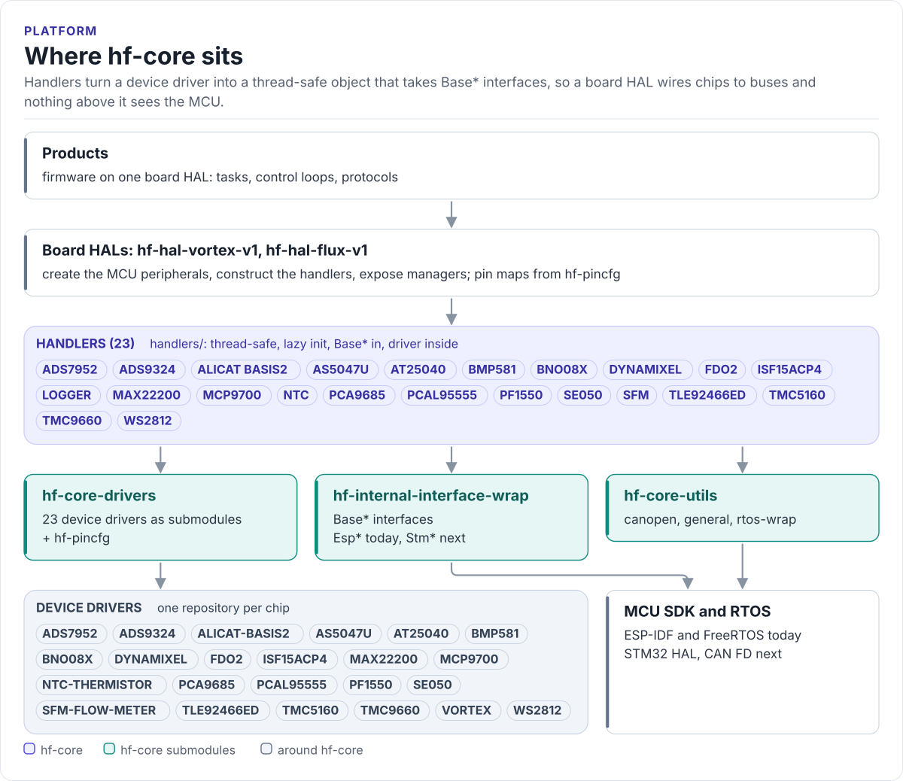

# Platform overview

The layers of the HardFOC platform, the repository that holds each one, and the path one call takes from a
manager to the chip.

<!-- figure: platform-layers -->
<picture>
  <source media="(prefers-color-scheme: dark)" srcset="diagrams/platform-layers.dark.svg">
  
</picture>
<!-- /figure -->

## Layers

| Layer | Repository | What it holds | Knows the MCU? |
| --- | --- | --- | --- |
| Product | product firmware repositories | Tasks, control loops, protocols | No |
| Board HAL | [hf-hal-vortex-v1](https://hardfoc.github.io/hf-hal-vortex-v1/), [hf-hal-flux-v1](https://hardfoc.github.io/hf-hal-flux-v1/) | Creates the buses and pins, constructs the handlers, exposes managers | Yes, in its platform files only |
| Handlers | **hf-core** `handlers/` | One thread-safe class per device family over `Base*` interfaces | No |
| Device drivers | [hf-core-drivers](https://github.com/hardfoc/hf-core-drivers) `external/` | One repository per chip, CRTP interface, no heap | No |
| Interfaces | [hf-internal-interface-wrap](https://hardfoc.github.io/hf-internal-interface-wrap/) (in hf-core-drivers `internal/`) | `BaseSpi`, `BaseI2c`, `BaseUart`, `BaseCan`, `BaseGpio`, `BaseAdc`, ... and their `Esp*` / `Stm*` implementations | Only the implementations |
| Pin maps | [hf-pincfg](https://hardfoc.github.io/hf-pincfg/) (in hf-core-drivers `internal/`) | Functional pin tables per board | Board-specific |
| Utilities | [hf-core-utils](https://github.com/hardfoc/hf-core-utils): hf-utils-rtos-wrap, hf-utils-general, hf-utils-canopen | RTOS wrapper, containers and filters, CANopen frames | Only the RTOS backends |

hf-core pins one commit of hf-core-drivers and one of hf-core-utils as submodules, so a HAL that pins hf-core
gets a set of drivers, interfaces and utilities that were built and tested together.

## One call, through the layers

A HAL manager reads the rotor angle from the AS5047U. Only the last step knows it runs on an ESP32.

```mermaid
sequenceDiagram
  participant M as HAL manager
  participant H as As5047uHandler
  participant D as AS5047U driver
  participant A as As5047uSpiAdapter
  participant S as BaseSpi (EspSpi on ESP32)
  M->>H: visitDriver([](auto& d) { return d.GetAngle(); })
  H->>H: lock the handler mutex, EnsureInitialized()
  H->>D: GetAngle()
  D->>A: transfer(tx, rx, len), static dispatch
  A->>S: Transfer(tx, rx, len)
  S-->>D: frame with CRC (retried on a CRC error)
  D-->>M: 14-bit angle, mutex released
```

## Design choices

| Choice | Why |
| --- | --- |
| Drivers are CRTP templates, handlers are plain classes | The driver dispatch costs nothing; the handler gives HAL code one non-template type per chip |
| Handlers take `Base*` references and never own them | The HAL decides bus sharing and lifetime; a test passes a mock |
| Lazy initialisation | Constructing a handler never touches the bus, so construction order does not matter at boot |
| One recursive mutex per handler, optional shared bus mutex | Methods may call each other; devices on one bus can share a lock |
| Raw function pointers with `void* user_data` for low-level callbacks | No `std::function` and no heap on interrupt paths |
| The host build is part of CI | It is the proof that everything above the interfaces is free of vendor headers |

## Source map

| Path | Contents |
| --- | --- |
| [`handlers/<chip>/`](../handlers/) | One handler: its CRTP adapter(s), the handler class, wrappers that expose it as `BaseGpio`, `BaseAdc`, `BaseTemperature` |
| [`handlers/common/`](../handlers/common/HandlerCommon.h) | `HandlerCommon.h` (delays, log routing), `PlatformMutexBackend.h`, the CANopen bridge |
| [`handlers/logger/`](../handlers/logger/Logger.h) | The `Logger` singleton and the per-MCU backend factories |
| [`cmake/hf_core_build_settings.cmake`](../cmake/hf_core_build_settings.cmake) | The build entry point for every consumer |
| [`CMakeLists.txt`](../CMakeLists.txt), [`CMakePresets.json`](../CMakePresets.json) | The host build |
| [`tests/host/`](../tests/host/CMakeLists.txt) | Host unit tests, mocks (`mocks/`) and the test harness (`support/`) |
| [`tests/docs/`](../tests/docs/CMakeLists.txt) | The code on these pages, compiled and run by the host build |
| [`examples/esp32/`](../examples/esp32/app_config.yml) | ESP32 test applications, one per handler or utility |
| `hf-core-drivers/`, `hf-core-utils/` | Submodules |

Next: [Handler model](handler-model.md).
