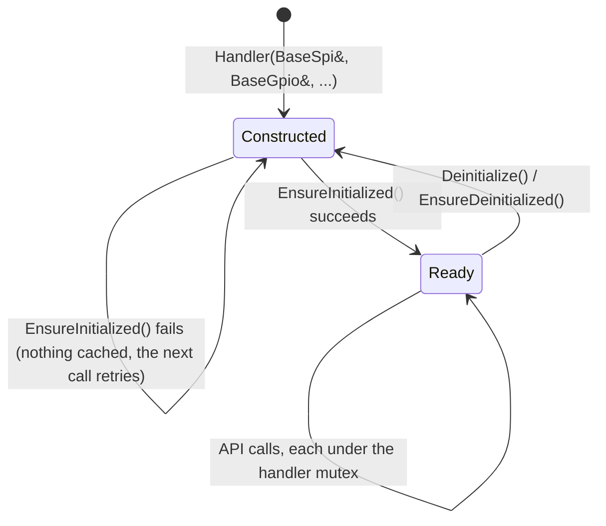

# Handler model

What every handler does the same way: construction, initialisation, locking, driver access, errors and
callbacks.

## Life of a handler



1. **Construct** with references to `Base*` interfaces the HAL owns. The constructor stores them; it does not
   touch the bus and does not create the driver.
2. **Initialise** on first use. `EnsureInitialized()` creates the CRTP driver over the handler's adapter,
   probes the chip and applies the configuration; it returns at once when already done. Most API methods call it
   themselves, so an explicit call is only needed to learn early that the chip is absent.
3. **Use** the typed API. Each public method takes the handler's mutex.

The interfaces must outlive the handler. Handlers are neither copyable nor movable.

## Inside a handler

| Piece | Example (TMC9660) | Role |
| --- | --- | --- |
| CRTP adapter | `HalSpiTmc9660Comm`, `HalUartTmc9660Comm` | Implements the driver's communication interface with `BaseSpi` / `BaseUart` / `BaseGpio` calls |
| Driver | `tmc9660::TMC9660<HalSpiTmc9660Comm>` | The chip logic, from the driver repository |
| Handler | `Tmc9660Handler` | Owns adapter and driver, locks, initialises, translates errors |
| Wrappers | `Tmc9660AdcWrapper`, `Tmc9660TemperatureWrapper`, `gpio()` | Present parts of the chip as `BaseAdc`, `BaseTemperature`, `BaseGpio` so other code can use them like MCU peripherals |

Other wrappers of the same kind: `Pca9685Handler::GetPwmAdapter()` (a `BasePwm`) and `CreateGpioPin()` on the
PCA9685 and PCAL95555 handlers (a `BaseGpio` per pin). These return `std::shared_ptr` and allocate once, when
created; create them at start-up.

## Locking

Every handler except the `Logger` holds an `RtosMutex`, a **recursive** mutex: a locked method can call another
public method of the same handler. Two tasks can share one handler.

Some devices share a bus with others and must not interleave transactions with them: an RS-485 line with
several instruments, or several sensors on one I2C bus. The handlers for those take an optional
`RtosMutex* bus_mutex`; pass the same mutex to every handler on that bus. A null pointer uses a private one.

| Takes `bus_mutex` | Bus |
| --- | --- |
| `AlicatBasis2Handler`, `DynamixelHandler`, `Fdo2Handler` | UART (shared line) |
| `Bmp581Handler`, `SfmHandler`, `Se050Handler` | I2C |

```cpp title="tests/docs/threading.cpp"
--8<-- "tests/docs/threading.cpp:shared-bus"
```

## Reaching the driver

Handlers expose the methods a HAL needs most. For the rest, use the driver itself:

| Access | Locked? | Handlers |
| --- | --- | --- |
| `visitDriver(fn)` (or `withDriver(fn)`) | Yes: takes the mutex, ensures initialisation, calls `fn(driver)` | AS5047U, ADS7952, ADS9324, BNO08x, ISF15ACP4, MAX22200, TLE92466ED, TMC5160, TMC9660, WS2812 |
| `GetDriver()`, `GetSensor()`, `GetDevice()`, `driverViaSpi()` / `driverViaUart()` | No: the caller synchronises | Most handlers; see each handler's method table |

`visitDriver()` returns what `fn` returns, or a default-constructed value when the driver is not available.

## Errors

Handlers return what fits the interface they stand in for: `hf_gpio_err_t` for GPIO-like handlers, `bool` for
initialisation, the driver's result type (`sfm::DriverResult<T>`, `se050` status codes) where the driver has a
rich one. Check every result. A failed `EnsureInitialized()` caches nothing, so the next call tries again; that
makes a chip that powers up late recover without special code.

Adapters pass bus and pin errors down to the driver instead of swallowing them. The SPI adapters of the ADS7952,
ADS9324, AS5047U and AT25040 return `bool` from `transfer()` (`false` when `BaseSpi::Transfer()` failed), and the
BNO08x adapters return `bool` from `GpioSet()`. The driver then fails the call (`Error::SpiError`, `false`, or the
AS5047U `BusError` sticky flag) and leaves its cached state as it was, so a glitch on the bus is never read as
data.

## Callbacks

Low-level callbacks in the `Base*` interfaces are plain function pointers with a `void* user_data`, not
`std::function`, so no heap and no capture on interrupt paths. A handler passes a non-capturing lambda and gets
itself back from `user_data`:

```cpp
int_pin.ConfigureInterrupt(
    hf_gpio_interrupt_trigger_t::HF_GPIO_INTERRUPT_TRIGGER_FALLING_EDGE,
    [](BaseGpio*, hf_gpio_interrupt_trigger_t, void* ctx) {
      static_cast<MyHandler*>(ctx)->OnInterrupt();
    },
    this);
```

Handlers that react to an interrupt do the bus work later, in task context: `Pcal95555Handler` sets a flag in
the interrupt and reads the chip in `DrainPendingInterrupts()`.

Next: [Threading and RTOS](threading.md).
