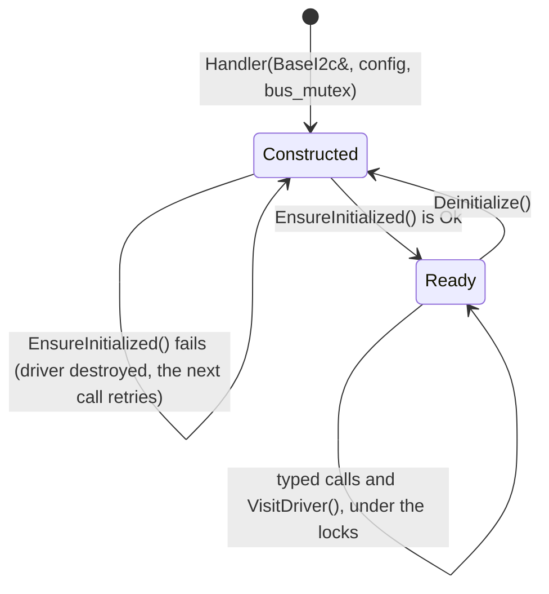

# Handler model

What every handler does the same way: construction, initialisation, locking, driver access, errors and
diagnostics. hf-core is moving from two handler families to the one shape of the HardFOC
[handler contract](https://github.com/hardfoc/.github/blob/main/standards/handler.md). The foundation for it is in
[`handlers/common/`](../handlers/common/HandlerBase.h); the handlers move over one at a time, and the
[migration status](#migration-status) says which already have.

## The standard handler



1. **Construct** with references to the `Base*` interfaces the HAL owns, a config, and optionally the mutex of
   a shared bus. The constructor stores them and touches no hardware.
2. **Initialise.** `EnsureInitialized()` builds the driver in place, probes the chip and applies the
   configuration. On failure the driver is destroyed and nothing is cached, so a chip that powers up late
   recovers on the next call. Typed methods initialise on demand; `VisitDriver()` does not.
3. **Use** the typed API. Every call holds the handler's lock and, if given, the bus lock.

A standard handler lives in `namespace hf`, derives from `hf::HandlerBase<Self, Driver>` and has these pieces:

| Piece | Example | Role |
| --- | --- | --- |
| Handler | `hf::Bmp581Handler` | Derives from `hf::HandlerBase`; owns the adapter and the config; one private `initializeLocked()` |
| Adapter | `hf::HalI2cBmp581Comm` | Derives from `hf::HalI2cCommBase`, which implements the driver's port hooks on a `BaseI2c` |
| Error mapping | `hf::ToStatus(bmp581::DriverError)` | The one place driver errors become `hf::Status`, in the adapter header |
| Driver | `bmp581::Driver<HalI2cBmp581Comm>` | The chip logic from the driver repository, in an `std::optional`: no heap |
| Diagnostics | `hf::Bmp581Diagnostics` | `hf::DiagnosticsHeader` first, then chip counters |

`hf::HandlerBase` gives every handler the same contract:

| Member | What it does |
| --- | --- |
| `EnsureInitialized()` | `Result<void>`; runs the start-up sequence once, retries after a failure |
| `Deinitialize()` | Runs the handler's optional `deinitializeLocked()` hook, then destroys the driver |
| `IsInitialized()` | No lock, no I/O |
| `VisitDriver(fn)` | Takes the locks; `NotInitialized` without calling `fn` before initialisation, else `fn(driver)`'s `hf::Status` |
| `CallDriver(fn)` (protected) | The body of a typed method: locks, initialises on demand, returns `fn(driver)`'s `hf::Result<T>` |
| `Header()` (protected) | A copy of the `DiagnosticsHeader`, for the handler's `GetDiagnostics()` |

There is no public `GetDriver()`. `VisitDriver()` hands the driver to a function that returns an `hf::Status`;
values leave by capture:

```cpp title="templates/handler/example/bmp581/test_bmp581_example.cpp"
--8<-- "templates/handler/example/bmp581/test_bmp581_example.cpp:visit"
```

A driver feature used through `VisitDriver()` in more than one place should become a typed method.

### Why CRTP

`HandlerBase` is a CRTP base rather than a member object. The public contract above is then written once and
cannot drift between handlers, which is exactly where the two current families differ. Dispatch stays static
(no virtual functions), the driver is stored in place, and the base uses only rtos-wrap, `hf_time` and
`hf::Status`, so a handler stays MCU-free and allocation-free. A member object would keep the same internals but
make every handler forward the public calls by hand.

### Adapters

The `Hal{Bus}CommBase<Derived, Port>` bases implement the port hooks of the
[driver contract](https://github.com/hardfoc/.github/blob/main/standards/driver.md) on an interface-wrap object,
so a new adapter is a few lines:

| Base | On | Hooks (all return `bool`) |
| --- | --- | --- |
| [`HalSpiCommBase`](../handlers/common/HalSpiCommBase.h) | `BaseSpi` | `Transfer(tx, rx, len)`; `Write`, `Read` for older drivers |
| [`HalI2cCommBase`](../handlers/common/HalI2cCommBase.h) | `BaseI2c` | `Write(addr, ...)`, `WriteRead(addr, ...)`, `Read(addr, ...)`; `WriteRegs`, `ReadRegs` for older drivers |
| [`HalUartCommBase`](../handlers/common/HalUartCommBase.h) | `BaseUart` | `Write`, `Read(data, len, timeout_ms)`, `FlushInput` |
| [`HalAdcCommBase`](../handlers/common/HalAdcCommBase.h) | `BaseAdc` | `ReadVoltageMv`; `ReadChannelV`, `ReadChannelCount`, `IsChannelAvailable` for older drivers |
| [`HalGpioCommBase`](../handlers/common/HalGpioCommBase.h) | `BaseGpio` pins | `GpioSet(CtrlPin, GpioSignal)`, `GpioRead` |

Every bus base also has `EnsureInitialized()` and the delay hooks `DelayUs()` and `DelayMs()`, which call
[`hf::DelayUs()` and `hf::DelayMs()`](../handlers/common/Delay.h): below 1 ms a busy-wait on
`hf_time::MonotonicUs()`, from 1 ms rtos-wrap's `os_delay_msec()`, rounded up. The second template argument is
the driver's port base: the adapter base derives from it, so its hooks also hide the forwarding stubs some
current ports declare. `HalGpioCommBase` chains under a bus base for a chip with control pins:
`HalSpiCommBase<D, HalGpioCommBase<D, Port>>`. A hook that fails keeps the interface code (`LastBusError()`,
`LastGpioError()`), so a failed write is never silent.

## Errors

The [error model](https://github.com/hardfoc/.github/blob/main/standards/errors.md) is interface-wrap's
`hf/iiw/Status.h`: `hf::Status` (twelve values) and `hf::Result<T>` (`value`, `status`, a 16-bit `detail`). Code
above the handler branches on `status` and logs `detail`. Errors are mapped once per layer:

- **Interface errors.** Each interface-wrap `Base*.h` defines `hf::ToStatus()` for its `hf_*_err_t`.
- **Driver errors.** The adapter header maps the driver's `Error` enum with one `switch` that lists every
  enumerator and has no `default`, so an error the driver adds later fails the build there. `ToResult()` turns a
  driver result into an `hf::Result` with the driver's error value as `detail`.

When the bus does not even start, `EnsureInitialized()` returns `DependencyNotReady` with the `hf_*_err_t` as
`detail`.

```cpp title="templates/handler/example/bmp581/test_bmp581_example.cpp"
--8<-- "templates/handler/example/bmp581/test_bmp581_example.cpp:errors"
```

## Locking

Each handler has its own recursive `hf::HandlerMutex` (rtos-wrap's `RtosMutex`). A handler on a shared bus (an
RS-485 line with several instruments, an I2C bus with several sensors) takes an optional
`hf::HandlerMutex* bus_mutex` as its last constructor parameter; pass the same mutex to every handler on that bus.
Every call takes the handler mutex first, then the bus mutex, and releases both before it returns. A handler never
calls another handler while it holds its locks. `GetDiagnostics()` takes only the handler mutex.

## Diagnostics

`GetDiagnostics()` returns the handler's own struct, whose first member is `hf::DiagnosticsHeader`:

| Field | Meaning |
| --- | --- |
| `initialized` | `EnsureInitialized()` has succeeded |
| `ok_count`, `error_count` | Calls that returned `Ok`, and anything else |
| `last_error`, `last_error_detail` | The last failure and its detail (the driver's `Error` value) |
| `last_error_us` | `hf_time::MonotonicUs()` at the last failure |

The header counts `EnsureInitialized()`, `Deinitialize()`, every typed call and every `VisitDriver()`.

## Adding a handler

[`tools/new_handler.py`](../tools/new_handler.py) writes a standard handler from
[`templates/handler/`](../templates/handler/Handler.h.in) and registers it:

```bash
python3 tools/new_handler.py --chip Foo42 --bus i2c --driver-repo hf-foo42-driver \
    --driver-header foo42.hpp --family environment
```

| Writes | Registers |
| --- | --- |
| `handlers/foo42/Foo42Handler.h`, `.cpp` | `HF_CORE_ENABLE_FOO42`: switch, sources, include directory, define and summary in `cmake/hf_core_build_settings.cmake`, plus the UART or ADC auto-enable |
| `handlers/foo42/HalI2cFoo42Comm.h`, with the error mapping | ON in the host build (`CMakeLists.txt`) |
| `tests/host/test_foo42.cpp` | The test in `tests/host/CMakeLists.txt` |
| | The folder in the docs generator's families, and a section on `docs/handlers/<family>.md` |

The defaults follow the driver contract (`foo42::FOO42`, `foo42::I2cInterface`, `foo42::Error`, `foo42::Result`,
`Initialize()`); a driver that does not follow it yet takes `--driver-class`, `--port-base`, `--error-enum`,
`--result-type` and `--init-method`. Then add the typed API and the config, review the generated error mapping,
and run the checks in [Testing and CI](testing.md#before-a-pull-request).

[`templates/handler/example/bmp581/`](../templates/handler/example/CMakeLists.txt) is the generator's output for
hf-bmp581-driver, built and tested on the host. It is a reference, not a handler: it is outside `hf_core`, and
`handler_template_fresh` fails when it drifts from the template.

## Migration status

No handler is on the standard model yet. The table lists where each one starts from.

| Handler | Today | Standard model |
| --- | --- | --- |
| `Ads7952Handler`, `Ads9324Handler`, `As5047uHandler`, `Bno08xHandler`, `Isf15acp4Handler`, `Max22200Handler`, `Tle92466edHandler`, `Tmc5160Handler`, `Tmc9660Handler`, `Ws2812Handler` | Rich family: `Initialize()`, `visitDriver()`, `DumpDiagnostics()`, driver created with `make_unique` | Not yet |
| `AlicatBasis2Handler`, `Fdo2Handler`, `DynamixelHandler`, `SfmHandler`, `Bmp581Handler`, `Se050Handler`, `Pf1550Handler` | Bus family: `EnsureInitialized()` and `bus_mutex`, driver result types passed through | Not yet |
| `At25040Handler`, `Mcp9700TemperatureHandler`, `NtcTemperatureHandler`, `Pca9685Handler`, `Pcal95555Handler` | Neither family | Not yet |
| `Logger` | Singleton, not a device handler | Stays as it is |

## Current handlers

Until a handler is migrated, it keeps its current shape.

### Locking

Every handler except the `Logger` holds an `RtosMutex`, a **recursive** mutex: a locked method can call another
public method of the same handler. Two tasks can share one handler. The handlers on a shared bus take an optional
`RtosMutex* bus_mutex`; pass the same mutex to every handler on that bus. A null pointer uses a private one.

| Takes `bus_mutex` | Bus |
| --- | --- |
| `AlicatBasis2Handler`, `DynamixelHandler`, `Fdo2Handler` | UART (shared line) |
| `Bmp581Handler`, `SfmHandler`, `Se050Handler` | I2C |

```cpp title="tests/docs/threading.cpp"
--8<-- "tests/docs/threading.cpp:shared-bus"
```

### Reaching the driver

| Access | Locked? | Handlers |
| --- | --- | --- |
| `visitDriver(fn)` (or `withDriver(fn)`) | Yes: takes the mutex, ensures initialisation, calls `fn(driver)` | AS5047U, ADS7952, ADS9324, BNO08x, ISF15ACP4, MAX22200, TLE92466ED, TMC5160, TMC9660, WS2812 |
| `GetDriver()`, `GetSensor()`, `GetDevice()`, `driverViaSpi()` / `driverViaUart()` | No: the caller synchronises | Most handlers; see each handler's method table |

`visitDriver()` returns what `fn` returns, or a default-constructed value when the driver is not available.

### Errors

These handlers return what fits the interface they stand in for: `hf_gpio_err_t` for GPIO-like handlers, `bool`
for initialisation, the driver's result type (`sfm::DriverResult<T>`, `se050` status codes) where the driver has a
rich one. A failed `EnsureInitialized()` caches nothing, so the next call tries again.

Their adapters pass bus and pin errors down to the driver instead of swallowing them: the SPI adapters of the
ADS7952, ADS9324, AS5047U and AT25040 return `bool` from `transfer()`, and the BNO08x adapters return `bool` from
`GpioSet()`. The driver then fails the call and leaves its cached state as it was.

### Wrappers

Some handlers present parts of their chip as `Base*` interfaces so other code can use them like MCU
peripherals: `Tmc9660AdcWrapper`, `Tmc9660TemperatureWrapper` and `gpio()` on the TMC9660,
`Pca9685Handler::GetPwmAdapter()` (a `BasePwm`) and `CreateGpioPin()` on the PCA9685 and PCAL95555 handlers (a
`BaseGpio` per pin). These return `std::shared_ptr` and allocate once, when created; create them at start-up.
On the standard model a wrapper lives in a fixed array owned by the handler and is created by `EnsureInitialized()`.

## Callbacks

Low-level callbacks in the `Base*` interfaces are plain function pointers with a `void* user_data`, not
`std::function`, so no heap and no capture on interrupt paths. A handler passes a non-capturing lambda and gets
itself back from `user_data`:

```cpp
int_pin.ConfigureInterrupt(
    hf_gpio_interrupt_trigger_t::HF_GPIO_INTERRUPT_TRIGGER_FALLING_EDGE,
    [](BaseGpio*, hf_gpio_interrupt_trigger_t, void* ctx) {
      static_cast<MyHandler*>(ctx)->OnInterrupt();
    },
    this);
```

Handlers that react to an interrupt do the bus work later, in task context: `Pcal95555Handler` sets a flag in the
interrupt and reads the chip in `DrainPendingInterrupts()`.

Next: [Threading and RTOS](threading.md).
