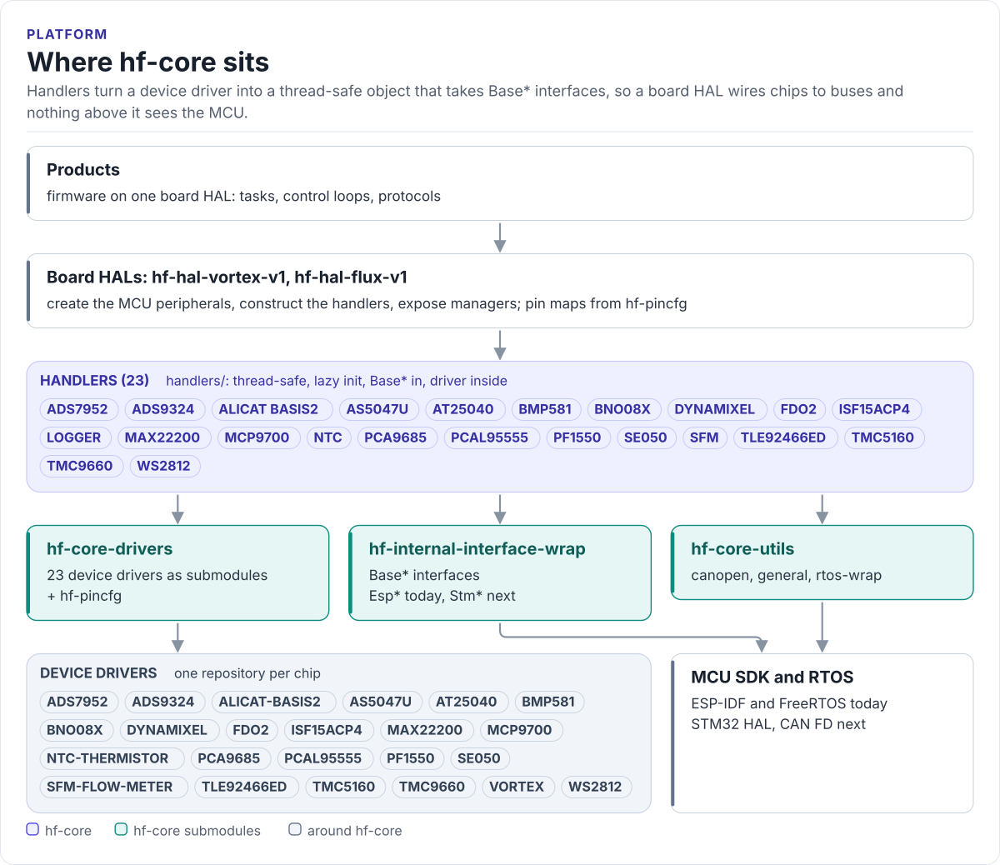

---
hide:
  - navigation
  - toc
---

HardFOC core library

# HardFOC Core

The layer between the HardFOC device drivers and a board HAL. hf-core wraps each driver in a thread-safe
handler that takes <code>Base*</code> interfaces, collects the MCU interfaces, RTOS wrappers and utilities, and
builds and tests all of it on a host machine with no MCU toolchain.

[Quickstart](quickstart.md){ .md-button .md-button--primary }
[Handlers](handlers/index.md){ .md-button }
[Source on GitHub](https://github.com/hardfoc/hf-core){ .md-button }

A device driver knows its chip and nothing else: it talks through a small CRTP interface and leaves locking,
bring-up order and bus sharing to its user. A board HAL knows its pins and buses. hf-core is what sits between
them, so that every HAL wires a TMC9660 or a BNO08x the same way and no code above the HAL includes an MCU SDK.

<!-- figure: platform-layers -->
<picture>
  <source media="(prefers-color-scheme: dark)" srcset="diagrams/platform-layers.dark.svg">
  
</picture>
<!-- /figure -->

## What you get

- **23 handlers, one per device family.** Each takes `BaseSpi`, `BaseI2c`, `BaseUart`, `BaseGpio` or `BaseAdc`
  references, initialises its driver on first use and serialises calls with a recursive mutex. See
  [Handlers](handlers/index.md).
- **One CMake file for every consumer.** `cmake/hf_core_build_settings.cmake` turns `HF_CORE_ENABLE_*` switches
  into sources, include directories, ESP-IDF requirements and compile definitions. See
  [Integration](integration.md) and [Feature switches](feature-switches.md).
- **A host build with mocks.** `HF_CORE_MCU=NONE`, `HF_CORE_RTOS=NONE`: handlers, drivers and utilities compile
  and run on Linux or macOS against scriptable fakes of the `Base*` interfaces. See
  [Host build and mocks](host-build.md).
- **Threads and locking without the RTOS in your code.** `RtosMutex`, `MutexLockGuard`, `BaseThread` and the
  OS abstraction map to FreeRTOS on target and to a no-op backend with a fake clock on the host. See
  [Threading and RTOS](threading.md).
- **CANopen helpers on `BaseCan`.** Frame builders and parsers for NMT, SDO, heartbeat, emergency and CiA 402,
  and a bridge to any `BaseCan`. See [CANopen](canopen.md).
- **A checked MCU boundary.** Only the interface implementations and a short list of files may include vendor
  headers; the host build proves the rest is portable. See [MCU boundary](mcu-boundary.md).

## Used by

| Repository | Uses hf-core for |
| --- | --- |
| [hf-hal-vortex-v1](https://hardfoc.github.io/hf-hal-vortex-v1/) | Vortex V1: TMC9660, AS5047U, BNO08x, PCAL95555, PCA9685, NTC and WS2812 handlers, the Vortex driver, CANopen |
| [hf-hal-flux-v1](https://hardfoc.github.io/hf-hal-flux-v1/) | Flux V1: ADS7952, MCP9700, NTC, TLE92466ED, MAX22200, Alicat BASIS-2, FDO2 and WS2812 handlers, CANopen |
| [hf-utils-and-drivers](https://github.com/hardfoc/hf-utils-and-drivers) | Superseded by hf-core; kept for older projects |

## Where to go next

-   :material-rocket-launch-outline: **[Quickstart](quickstart.md)**

    ---

    Add hf-core to a project and drive a handler in 20 lines.

-   :material-layers-outline: **[Platform overview](architecture.md)**

    ---

    The layers, the repositories and how one call travels through them.

-   :material-chip: **[Handlers](handlers/index.md)**

    ---

    Every handler, its driver, its interfaces and its switch.

-   :material-test-tube: **[Host build and mocks](host-build.md)**

    ---

    Build and test without hardware, from hf-core or from a HAL.

